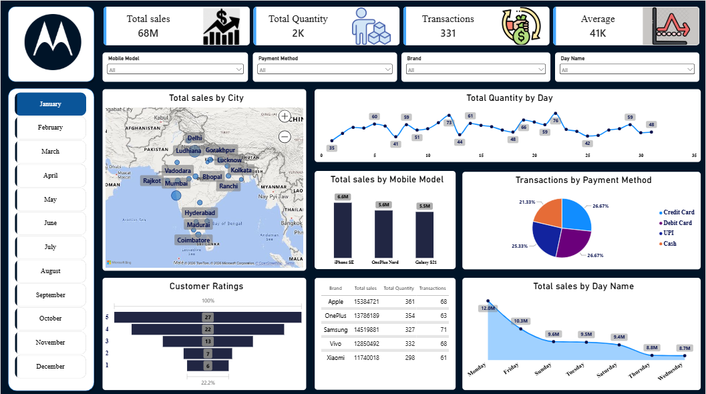

# 📱 Mobile Sales Analysis Dashboard (Microsoft Power BI)

## 📌 Project Overview

This project is an **Interactive Mobile Sales Analysis Dashboard** built using Microsoft Power BI to analyze mobile sales performance, customer ratings, payment preferences, brand performance, and sales trends.

The dashboard provides a consolidated view of key business metrics through interactive KPI cards, charts, a city-wise sales map, and slicers. It helps users explore sales data from multiple perspectives and derive meaningful insights to support data-driven business decisions.

## 🎯 Project Objective

The primary objective of this project is to develop an interactive Power BI dashboard that provides insights into mobile sales performance, customer behavior, and purchasing patterns.

The dashboard enables business stakeholders to:

- Monitor overall mobile sales performance.
- Analyze sales and quantity trends across days.
- Compare sales performance across mobile models and brands.
- Understand customer payment method preferences.
- Evaluate customer ratings.
- Explore city-wise sales distribution.
- Compare transaction volumes across brands.
- Support data-driven business decision-making.

## 📊 Key Performance Indicators (KPIs)

The dashboard highlights the following key metrics:

- 💰 **Total Sales:** 68M
- 📦 **Total Quantity Sold:** 2K
- 🧾 **Total Transactions:** 331
- 📈 **Average Sales:** 41K

*Note: KPI values reflect the dashboard screenshot and may change when filters are applied.*

## ❓ Business Questions Answered

This dashboard helps answer the following business questions:

### 💰 Sales Performance Analysis

- What are the overall mobile sales?
- How do sales vary across different days of the week?
- Which mobile models generate the highest sales?
- How does sales performance compare across cities?

### 📦 Quantity Analysis

- What is the total quantity of mobile phones sold?
- How does the quantity sold change throughout the month?
- Which days record higher or lower quantities sold?

### 📱 Brand and Mobile Model Analysis

- Which mobile models contribute the most to total sales?
- How do brands compare in terms of sales, quantity, and transactions?
- Which mobile models should be examined further for sales performance?

### 💳 Payment Method Analysis

- Which payment methods are used most frequently?
- How are transactions distributed across payment methods?
- What proportion of transactions uses Credit Card, Debit Card, UPI, and Cash?

### ⭐ Customer Ratings Analysis

- How are customer ratings distributed?
- How many customers provide ratings at different levels?
- What does the rating distribution indicate about customer feedback?

### 🌍 Geographic Analysis

- Which cities contribute to mobile sales?
- How does sales performance vary geographically?
- Which cities could be explored further for business opportunities?

## 📂 Dataset Used

**Dataset:** Mobile Sales Data

The dataset contains transaction-level information, including:

- Transaction ID
- Day, Month, Year, and Day Name
- Brand
- Units Sold
- Price Per Unit
- Customer Name
- Customer Age
- City
- Payment Method
- Customer Ratings
- Mobile Model

The dataset was cleaned and prepared using **Power Query** before being used in the dashboard.

## 🛠 Tools & Power BI Features Used

- Microsoft Power BI Desktop
- Power Query for Data Cleaning and Transformation
- Data Modeling
- DAX Measures
- KPI Cards
- Interactive Slicers
- Line Charts
- Pie Chart
- Bar Charts
- Funnel Chart for Customer Ratings
- Map Visualization
- Tables and Data Aggregation
- Dashboard Formatting and Design

## 🎛 Interactive Dashboard Features

Users can explore the dashboard using the following filters:

- **Month:** Analyze sales across different months.
- **Mobile Model:** Filter performance by mobile model.
- **Payment Method:** Explore transactions by payment type.
- **Brand:** Analyze performance for selected brands.
- **Day Name:** Compare metrics across days of the week.

The visuals respond to report filters, allowing users to explore the data interactively.

## 📊 Skills Demonstrated

- Data Cleaning and Transformation
- Exploratory Data Analysis
- Data Visualization
- Power Query
- DAX and KPI Reporting
- Interactive Dashboard Development
- Business Intelligence
- Sales Performance Analysis
- Customer Analytics
- Dashboard Design

## 🚀 How to Use This Project

1. Download the `.pbix` file from this repository.
2. Open it using Microsoft Power BI Desktop.
3. Explore the report visuals and interactive slicers.
4. Use the filters to analyze sales by month, brand, mobile model, payment method, and day name.

The source dataset is also included in this repository for reference, subject to the dataset's sharing permissions.

## 🙏 Acknowledgements

This project was completed as part of my Data Analytics learning journey.

It helped me practice data preparation, analytical thinking, KPI development, and interactive dashboard design using Microsoft Power BI.

## 👩‍💻 Author

**Ankita Chaudhary**  
Aspiring Data Analyst

**Skills:** Excel • SQL • Power BI • Python

## 📷 Dashboard Preview

